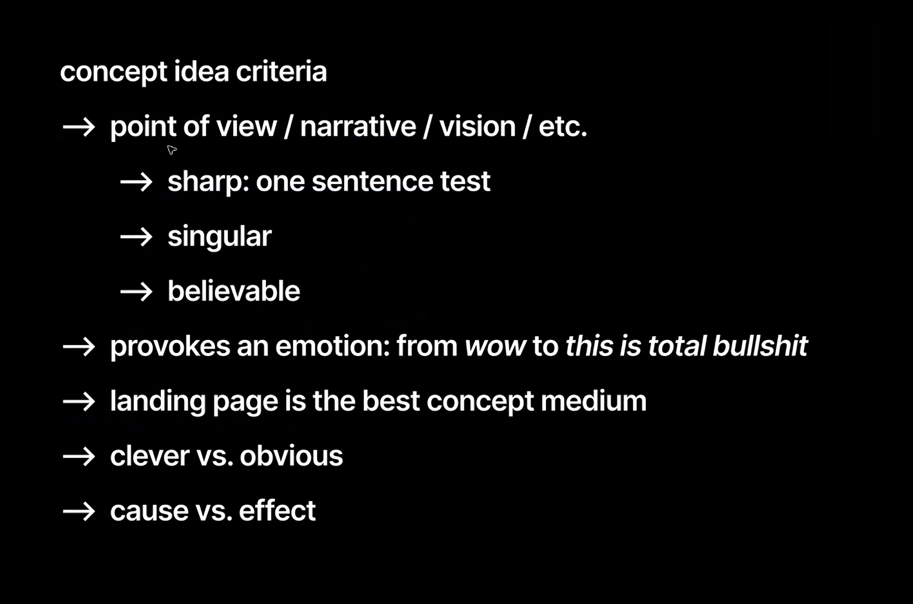

# Фидбек по концепту

Один файл на весь курс. Сессии — новые первыми. Статус стоит прямо у рекомендации, после `→` — где применено или почему нет.

Статусы: `✅` применено · `🟡` частично · `⬜` не начато · `🚫` отклонил (с причиной) · `➖` неактуально (с причиной).
Цель к финалу — ни одного `⬜` и `🟡`: по каждому комменту решение.
Сверка с кодом — по `src/App.jsx` и `src/data.js`, дата сверки в шапке сессии.

## Сессия 5 — 20.10.2026

Источник: `course/feedback sessions/5 session 20 october/` (часть Тимура и выжимка). Меня на встрече не было — Илья смотрел Figma и прототип сам.

### Главное
Визуал пока не убеждает: мало работы с рефами, есть признаки AI-слопа. Подбор должен ощущаться магией, а карточка машины — вызывать «вау». Ценность — подача туда, куда надо, а не сама машина.

### Рекомендации Ильи
1. ⬜ **Одно направление стиля: антиква + непривычные цвета.** Гротеск заменить («ужаснейший»), размазанный капс убрать, антикву — для акцентов. Остальные варианты — дефолтные скетчи.
2. ⬜ **Убрать признаки AI-слопа:** стрелки шрифтом (`->`) → иконкой; кремовый фон, италик в заголовке, капсовый eyebrow, лишний второй акцент.
3. ⬜ **Рефы с Are.na, Cosmos, Awwwards**, не из Google Images. Нашёл реф — не придумывай с нуля.
4. ⬜ **Руль вместо буквы в логотипе — попсовый приём.**
5. ⬜ **Форма — визардом, как в Airbnb:** город → сразу даты → сразу параметры. Поп-апы раскрывать прямо под полями.
6. ⬜ **Подбор ощущается магически:** пауза на несколько секунд с шагами — смотрю каталог, фильтрую, проверяю доступность. Рефы на умный/AI-поиск. «На основе чего решили» и альтернативы — оставить.
7. ⬜ **Карточка машины — «вау, бронирую».** Машина в контексте цели и города (Сочи — море, горы, Петербург — Исаакий, мосты), а не в гараже. Рассказ языком продающего поста, а не список фактов. «Показать ещё» — альтернативы списком.
8. ⬜ **Машина — не визуальный якорь.** Ценность — подать любую машину туда, куда надо. Машина — как код у программы: на лендинге её не выпячивают.
9. ⬜ **Лендинг подточить под выбранный стиль** — и финалить. Красную плашку тоже на фоне Сочи.

---

## Сессия 4 — 17.10.2026

Источник: `course/feedback sessions/4 session 17 october/` (часть Тимура и выжимка).

### Главное
Подбор без вводных ощущается как впаривание — параметры спрашивать до подбора. Сценарий закончить на бронировании. Визуал искать вне транспорта, от эмоций концепта.

### Рекомендации Ильи
1. ✅ **Чипы — вводные до подбора, а не фильтры после.** Кнопка «Параметры» с поп-апом всех чипов, блок параметров объединить с началом. Потом: «под твои ожидания подходит Changan, ещё есть вот эти».
   → 20.10: в форме хиро ячейка «Параметры» → поп-ап «Еду / С кем / Авто». На Э2 вместо рядов чипов — строка «Учли: …» и «Изменить» (тот же поп-ап), бейдж «Под ваши параметры», ниже «Или посмотрите». Базовые цели под хиро убраны — остались только «вы могли не знать».
2. ✅ **Почасовая — куда возвращать машину.** Посуточно — туда же, где взял; почасово — оставляешь где-то, как в каршеринге.
   → 20.10: решил шире — галочка «Вернуть в другом месте» в форме для обоих режимов: где забрали / в нашей точке / где удобно, как каршеринг. Обе опции без доплаты — сервис про свободу.
3. ✅ **Локация:** отель и дом — ввод адреса; аэропорт и вокзал — выбор из списка.
   → 20.10: в пикере аэропорты и вокзалы списком, отель и дом — поиском адреса с подсказками по городу; принимается любой введённый адрес.
4. ✅ **Доставка в цене суток.** Доплата за доставку — тёмный паттерн против обещания «машина там, где надо».
   → 20.10: доп «Доставка к адресу» убран, в счёте Э3 — «Подача и возврат — включено».
5. ✅ **Экран брони — только цена, залог и «Забронировать»**, без полей и чекбоксов, сразу к шагу с картой.
   → 20.10: справа на Э3 — «Где / Когда / Вернуть» с «Изменить», итог, счёт, залог, «Забронировать». Безлимит пробега ушёл в допы.
6. ✅ **Закончить на бронировании** заглушкой «конец концепта», оформление дальше не делать.
   → 20.10: финал — карта с точкой, превью SMS, плашка «Здесь концепт заканчивается». Э4, Э6, «Моя бронь» удалены (код в `953ffd6`).
7. ✅ **Мелочи:** переиспользовать фразу «такие машины в парке в Москве» в блоке; страница скроллится под поп-апом; баги и мусор.
   → 20.10: заголовок «Какие машины в парке [в Сочи ▾]» с выбором города, нижняя строка убрана; под любым поп-апом страница не скроллится. Баги закрыты по ходу 20.10: адаптив Э3, системные селекторы, ленты без полосы прокрутки, дубль кнопки брони, висящие предлоги, переносы в допах, светлый финал.
8. ⬜ **Референсы вне транспорта**, от эмоций: свобода, антитревожность. Awwwards, Cosmos — забирать типографику, лейаут, цвет.

---

## Сессия 3 — 10.10.2026

Сверено с кодом 16.10.2026.

Источник: `course/feedback sessions/3 session 10 october/` (транскрипт, часть Тимура и Ильи). Прототип в этот раз не менялся — показывал POV, эмоцию, структуру экранов и лендинга в Figma.

### Главное
POV принят. Два ключевых экрана — форма подбора и результат подбора; остальное по остаточному принципу. Лендинг — презентация концепта для портфолио, а не промо сервиса.

### Что я показал и спросил
- POV: выкинуть каталог, по вводным дать 2–3 машины, у каждой своё «для чего». Эмоция — убрать тревогу; каталог пугает объёмом, как выбор джинсов на маркетплейсе. Способ — упрощение и ограничение. Не Тиндер, а осознанный выбор «беру, потому что…».
- Что делать, если ни одна машина не подошла?
- Что делать с каталогом из 50 машин?
- Консьерж — не хочу: пусть подбирает робот, чуткий и гибкий.
- Люди привыкли выбирать класс авто (эконом, комфорт, премиум) — может, так и надо?
- Нужны ли блоки «Куда можно поехать» и «Преимущества»?

### Рекомендации Ильи
1. ✅ **Машины в подборе должны различаться кардинально.** Если оставить 3–4 варианта, разница «SUV за 5 000 против SUV за 5 200» не поможет выбрать. Решить, по каким осям машины отличаются, хотя бы для прототипа.
   → 16.10, Э2: оси — привод, коробка, места, багажник, класс. У каждого переключателя заранее видна цена, после — плашка «что лучше / что хуже».
2. 🟡 **Реперсонализация вместо каталога.** Если не подошло — понять почему (почти всегда это цена или задача) и дать подкрутить вводные. Показывать решение системы: «для частого серпантина решили, что нужен высокий клиренс, вот машина за подходящую цену». Человек отвечает «в город не собирался, давай попроще и дешевле» — подбор пересобирается. Пример Ильи — подбор LLM-модели под задачу агента: остальные варианты либо оверкилл, либо слабее.
   → 16.10, Э2: «Что учли» показывает решение системы, цели и переключатели меняются на месте. 20.10: пересобрать подбор — «Изменить» параметры. Нет вопроса «почему не подошло».
3. 🚫 **Каталог — второй флоу, мельком.** Есть те, кто знает, что хочет (например, только Мерседес). Упор на подбор, каталог показать вскользь. Для концепта хватит ~10 ходовых известных машин, не 50.
   → 16.10: каталог убрали совсем. Кто знает, что хочет, — блок «Парк» на лендинге (3 машины на задачу, клик → карточка) и избранное.
4. ✅ **Без консьержа.** Роботизированная безликость лучше для массовой аудитории: консьерж даже дешёвый ощущается премиальным.
   → Согласились 10.10.
5. 🟡 **Классы авто — проверить от первых принципов.** Все так делают — значит, либо идти в противоположную сторону (облажаться или сделать единорога), либо понять, зачем это людям. Не копировать фильтры, потому что они у кого-то есть. Илье лично марка безразлична — главное нормальная машина в бюджете.
   → 16.10: в «Парке» табы по задаче поездки, а не по классу; класс — только переключатель «классом повыше». От первых принципов пока не проверяли.
6. 🟡 **«Куда можно поехать» — абстрактные фреймы.** Не «Сочи — горы», а «горы», «побережье», «исторический город»; под фрейм — список городов, где есть сервис (горы → Сочи, Мурманск, Алтай). Конкретная связка город + занятие сужает: в Калининград едут не только на побережье. Проверить, как фрейм считывается.
   → 16.10: блок «Какие планы в [город]?» — базовые цели (горы, море, дача, по трассам…) + по 3 местных «вы могли не знать». Конкретные места остались, но как дополнение к целям.
7. 🟡 **Экран результата — найти UX-референс.** Худшее — оставить текущий layout и просто убрать карточки до трёх: выглядит как «втюхивают первое попавшееся». Тиндер-свайпы — заезженный паттерн, не брать. Поискать нестандартное взаимодействие по SCAMPER из лекции Миши (заимствовать, убрать, добавить).
   → 16.10: одна машина + переключатели с ценой заранее. Референс не искали.
8. 🟡 **Убрать «Преимущества» и промо.** ОСАГО, поддержка 24/7 — ценности для концепта нет.
   → 16.10: промо и сезонные офферы убраны. Блок «Что мы обещаем» оставил — это главные страхи Саши (состояние машины, залог).
9. **Лендинг — презентация концепта, не промо.** Цель — показать, как я мыслю: привлечь проект, работу или нетворк. Продавать сервис не нужно.
10. 🚫 **Карта как у Uber и Авиасейлс.** Не поможет: города и так ограничены, машину в другой город не подадут.
11. ✅ **К следующему разу — обновлённый UX в кликабельном прототипе.** Пересобрать основные экраны под новый UX; если останется время — сразу прикрутить визуальные референсы. Референсы сами по себе Илья не фидбечит — смотрит, как они ложатся на концепт.
   → 16.10: лендинг, Э2 и Э3 пересобраны в коде; визуал хиро по рефу Яндекс Проката.

### Озвученные идеи
- **Одна машина + переключатели** (моя, Илья поддержал): показать одну подобранную машину с параметрами, ниже — «здесь мне лучше вот это» (например, другая коробка). Переключил — подбор пересобирается и появляется другая машина. Подсказкой показать, что есть ещё две, лучшие по другим параметрам, — чтобы не казалось, что выбора нет.
- **Пресеты поездок** полезны и на лендинге до брони, и внутри подбора.
- Бутиковый каршеринг на 7 машин — тоже допустимый формат автопарка.

### Мои выводы
- Интервью с другом из Питера, который протестил все каршеринги и любит выезжать за город: как он принимает решение и важен ли ему класс авто.
- В сценариях «Куда можно поехать» не ставить явных ограничений.
- Фокус до вторника: два экрана — форма и результат подбора.

---

## Сессия 2 — 06.10.2026

Источник: `course/feedback sessions/2 session 6 october/` (транскрипт, часть Тимура и Ильи).

### Главное
Флоу сейчас — обычный каршеринг: поменялась только точка подачи (аэропорт, вокзал, отель). Контекст путешествия не используется. Нужен point of view, без него Илья не может предметно комментировать.

### Что я спросил
- Лендинг не передаёт ценность и отличие — хочу докрутить по конкурентам.
- Каталог тянет в UX-фичи. В чём тогда концепт и через что сделать вкусный визуал? Думал: продуктовую часть минимально, потом нестандартная визуализация машин, один-два ключевых экрана (главный и выбор машины).

### Рекомендации Ильи
1. ✅ **Шаг назад к POV.** Сначала ответить, что я вообще хочу показать: флоу бронирования каршеринга все уже видели. Сформулировать vision: мобильность в путешествии — она какая? Например, безопасная, антитревожная. Потом разложить vision на составные части. Подкреплять ресерчем не обязательно; хороший концепт и должен рождать несогласных — сейчас всё «слишком безопасно».
   → `project/pov.md`: «Мы не даём выбирать машину — мы подбираем её под твою поездку». Показан Илье 10.10.
2. **Почему контекст сильный.** Путешествие — уязвимая и тревожная ситуация: всё незнакомое, даже внутри России другой транспорт и развязки. Продукт должен идти навстречу именно этому.
3. 🟡 **Визуал вытекает из идеи.** Хорошая картинка придёт следующим шагом после хорошей идеи и фич, не из абстрактных референсов.
   → Визуал пока не выбран — ок, сначала POV.
4. ✅ **Убрать примеры машин и промо-блоки с первого экрана.** Вместо них — структурированная форма запроса (не промпт): «еду в Сочи, в планах горы и серпантины, нас 4, 8 чемоданов». Всё на одном экране.
   → 16.10: в хиро только форма; цели — блоком сразу под ним. Людей и багаж спрашиваем на Э2 переключателями.
5. 🟡 **Результат — две рекомендации.** «Впитали, нашли 4 варианта, ранжировали — берите это, если так, или это, если так». Больше ничего не предлагать. Анимация этого процесса задаёт вайб первой точки касания.
   → 16.10: одна машина вместо двух, остальные — через переключатели с ценой. Анимации подбора пока нет.
6. ⬜ **Много можно сделать между экранами** — переходы, загрузки.
7. ➖ **Оформление брони — как резервирование опыта**, а не сервисная форма или заказ такси. Референс: Airbnb — тревожный процесс, хорошо проработано доверие, много шагов, но не ощущается длинным.
   → 20.10: неактуально — сценарий заканчивается на брони (С4 №6).
8. ✅ **Подбор = подбор.** Фильтр по типам дорог с подсказкой — правильное направление, но усилить: не закидывать опциями.
   → 20.10: опции спрятаны в поп-ап «Параметры», на Э2 — одна строка сводки.
9. ➖ **Вход через банк приоритизировать** — SMS ждать долго.
   → 20.10: неактуально — оформления в сценарии нет (С4 №6). Вход остался только для избранного.

### Озвученные идеи (примеры, не задание)
- Консьерж: один звонок или форма — «прилетаю в 13:30, заселяюсь туда-то, планы такие». Сервис сам подбирает машину, пригоняет, заправляет, ставит допы. Обычно консьерж доступен только богатым — тут он для всех.
- Гиперперсонализация подбора (Илья признаёт, что это его любимая тема, и он не автолюбитель — проверять на своей аудитории).

### Шпаргалка Ильи: concept idea criteria

Слайд Ильи и его пояснения. Не входит в программу — его личный чек-лист.

- [ ] **Point of view / narrative / vision.** Прослеживается и в формулировке идеи, и в прототипе.
  - [ ] **Sharp: one sentence test** — объясняется одним предложением, а не эссе на три абзаца.
  - [ ] **Singular** — одна идея, без «а ещё вот это, а ещё вот это».
  - [ ] **Believable** — в неё легко поверить: не лекарство от всех болезней, реализуемо в ближайшие годы.
- [ ] **Provokes an emotion** — любую, от «вау» до «что за бред»; от неё тоже можно отталкиваться.
- [ ] **Landing page is the best concept medium** — идею можно показать именно лендингом, а не выставкой или галереей.
- [ ] **Clever vs. obvious** — одно предложение, и возникает «ну да, логично, как раньше не подумал».
- [ ] **Cause vs. effect** — в прототипе понятно, что из чего следует: зачем человек это берёт и что получает.

Галочки ставлю, когда POV проходит пункт.

### Мои выводы
- Сделать шаг назад: упражнение из уроков Миши, рефы, сформулировать POV одним предложением.
- Уйти от каталога к персональному подбору и живому языку — совпадает с наблюдением, что каршеринги намеренно сокращают выбор.

---

## Сессия 1 — 03.10.2026

Источник: `course/feedback sessions/1.1` и `1.2 session 3 october.txt` (часть Тимура и Ильи). Сверено с кодом 06.10.2026.

### Главное
Discovery и Define нравятся. Заточка под узкую задачу — каршеринг для путешествий по России — правильная. Не хватает одной отличительной фичи и сквозного сценария.

### Рекомендации и идеи
- 🟡 **Отличительная фича против Яндекс Драйва.** Моя ставка — активный отдых и допы (инвентарь, коллабы). У Драйва сценарии «на работу, аэропорт, дача…», туризма нет.
  → Сценарии «Куда едете», допы в машину на Э3; на Э1 фича не названа.
- ⬜ **Слой заботы при получении машины** (идеи Ильи): парковка в аэропорту уже оплачена и входит в аренду; маршрут до отеля уже в навигаторе; сервис узнаёт у отеля про парковку.
  → 20.10: подача к отелю и дому — в цене, адрес вводится в пикере. Парковки и маршрута нет.
- ⬜ **Офлайн-режим** (моя идея, Илья поддержал): всё работает без интернета, контакты под рукой.
- 🟡 **Теги на карточках** (моя идея): СБП, без депозита, бесплатная отмена, новое авто.
  → СБП, отмена, депозит на Э4; на карточках только 4×4, бокс, 7 мест.
- 🟡 **Без обязательного приложения.** Илья «захейтил бы» апку ради одной аренды: всё на лендинге, апдейты в Telegram / WhatsApp / почту. Для концепта ещё и проще.
  → Бронь на странице, SMS на Э6; выбора канала нет.
- ➖ **Сквозной сценарий** от лендинга до возврата: в каждой точке касания — UX-фишка, можно подсмотреть у конкурентов.
  → 20.10: неактуально — по С4 №6 сценарий заканчивается на брони: лендинг → подбор → машина → финал.
- ✅ **Процесс:** сразу грубый драфт, скоп определяю сам, лишнее режу.
  → Драфт в коде.
- 🟡 **Порядок** — lo-fi (хоть чёрно-белый) → полиш UX → визуал.
  → Драфт на стартовой дизайн-системе, визуал не выбран.
- ⬜ Опционально: спросить знакомых и форумы про боли каршеринга.
