# С8: какие рефы Миша смотрел по ON MOVE (24:00–29:15)

Миша искал на Behance по запросу «editorial». Ниже кадр и его реплика к нему.

## 24:20 · выдача Behance «editorial»
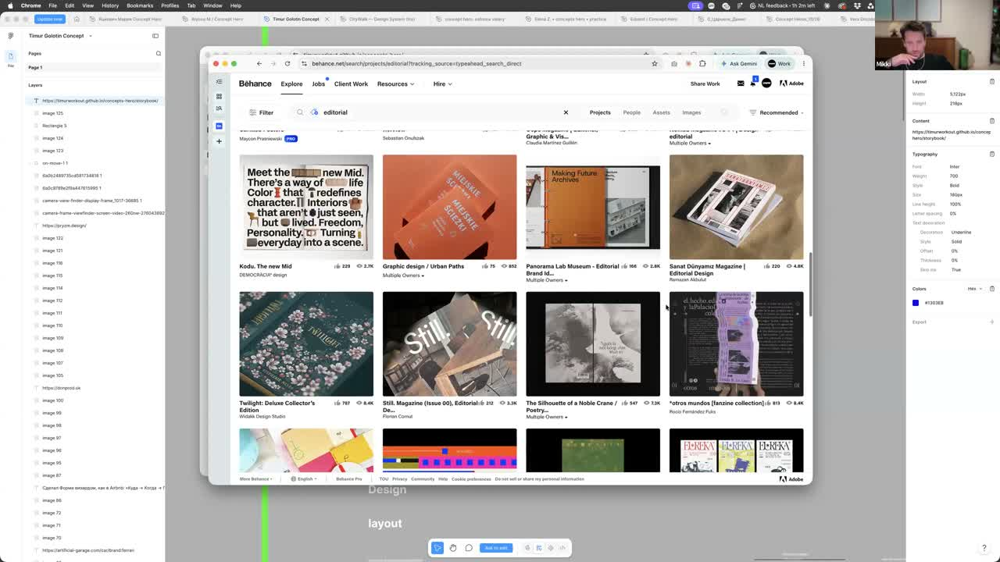
> «слово „эдитория“ лучше всего подходит, сейчас мы быстро найдём что-то вайбовое»

## 25:00 · книга с зелёным пейзажем
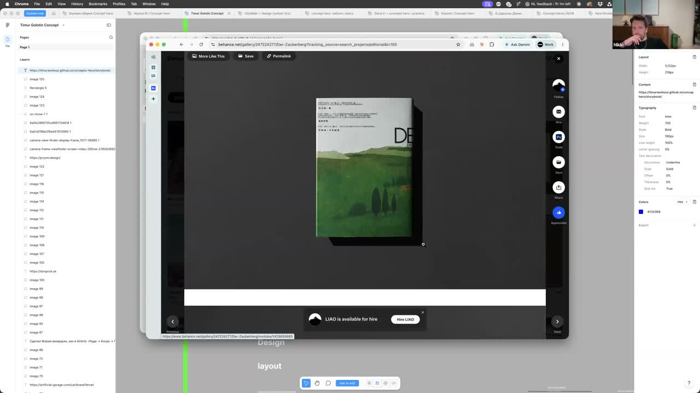
> «тут просто книга, поэтому нам не повезло… нужен не книга, а журнал, чтобы были развороты»

## 25:54 · «Where will you go?», сайт про ретриты
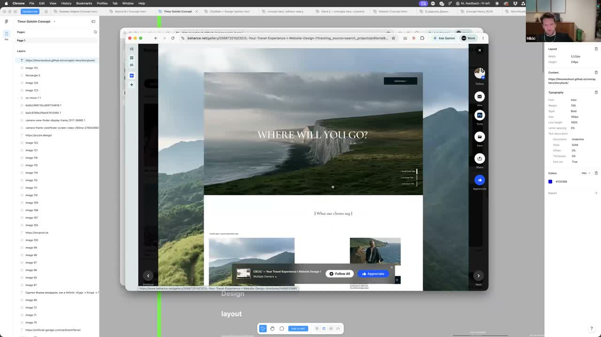
> «прям хочется поехать сюда… шрифты унылые… но вот это поприкольнее выглядит. Вот они прям конкретные, путешествия»

## 26:50 · выдача Behance по travel
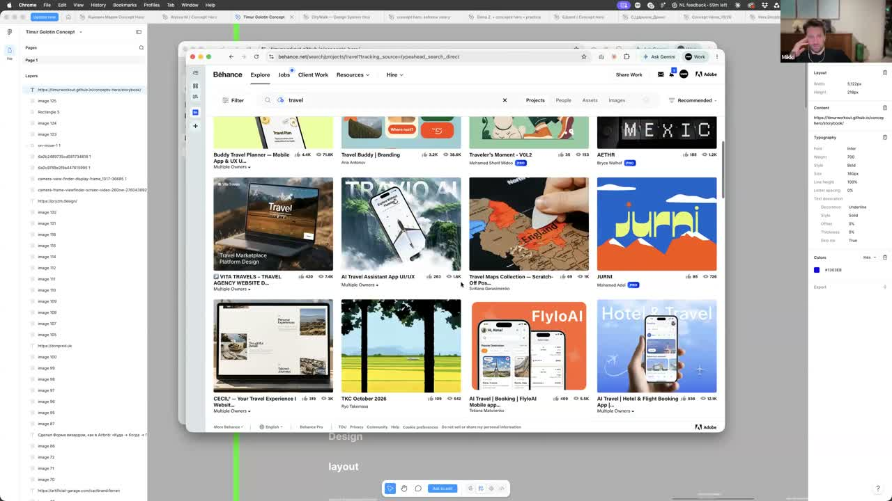
> «вот это, наверное, сейчас подойдёт»

## 27:05 · Tuscany retreat, тёмная карточная сетка
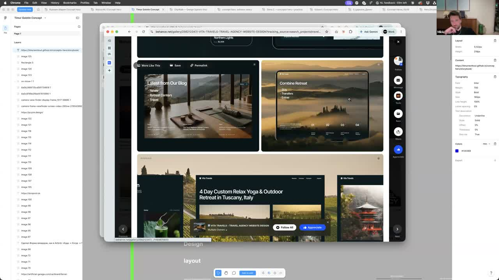
> «это суперстандартный дизайн, в хорошем смысле, просто он аккуратный… фоточки нормальные, продают»

## 27:13 · «Can't find the perfect retreat?», маршрут с фотками
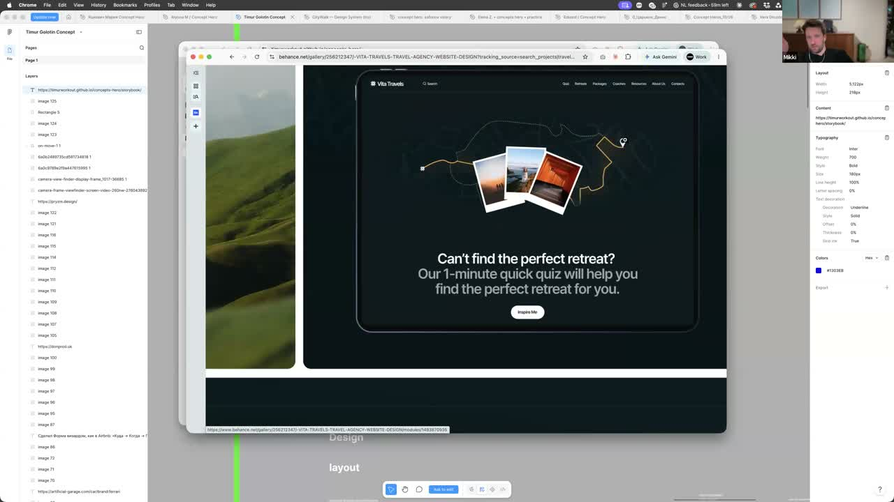
> «суперобычная швейцарская вёрстка… но сильно более в тему, вот эти маршрутики. Вместо карточек поставь свои машинки»

## 27:26 · снова выдача (Norway, ensemble…)
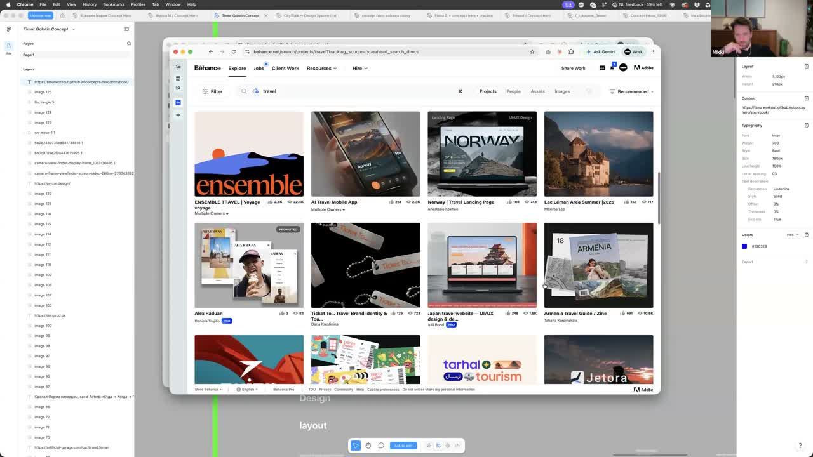
> «вот это прикольно выглядит»

## 27:40 · коллаж-стилизация (горы, лошадь, вырезки)
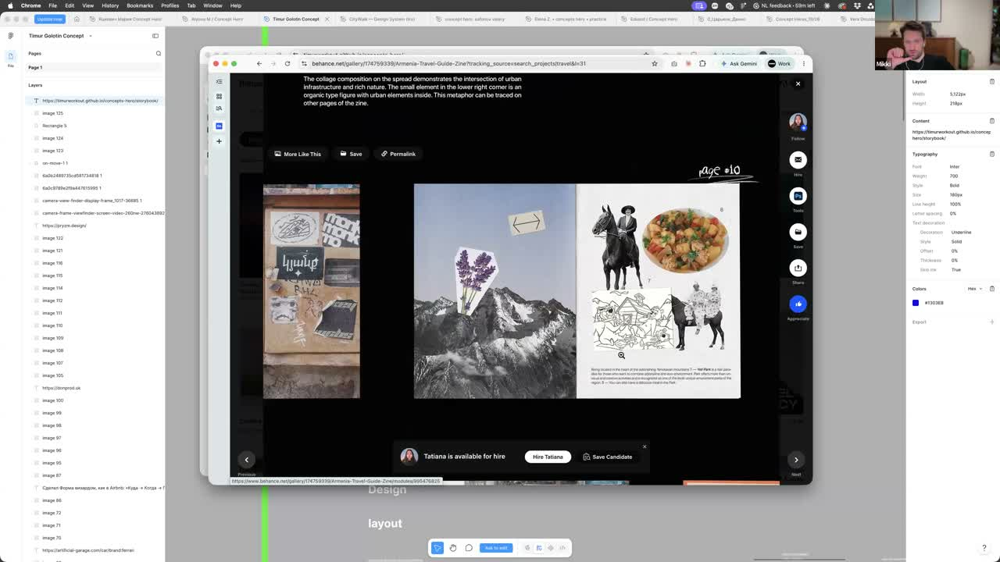
> «каждую страну можно стилизовать шрифтами, цветами… это крафт прям такой, офигенный. Не сгенерировано, а кто-то посидел и заморочился»

## 28:07 · Travel Agency, палатка в горах
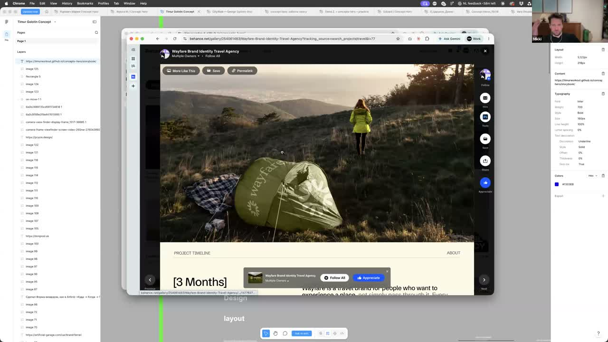
> «классная фотка, кстати… и вот цвета гораздо более подходящие»

## 28:15 · жёлтый знак на фоне гор
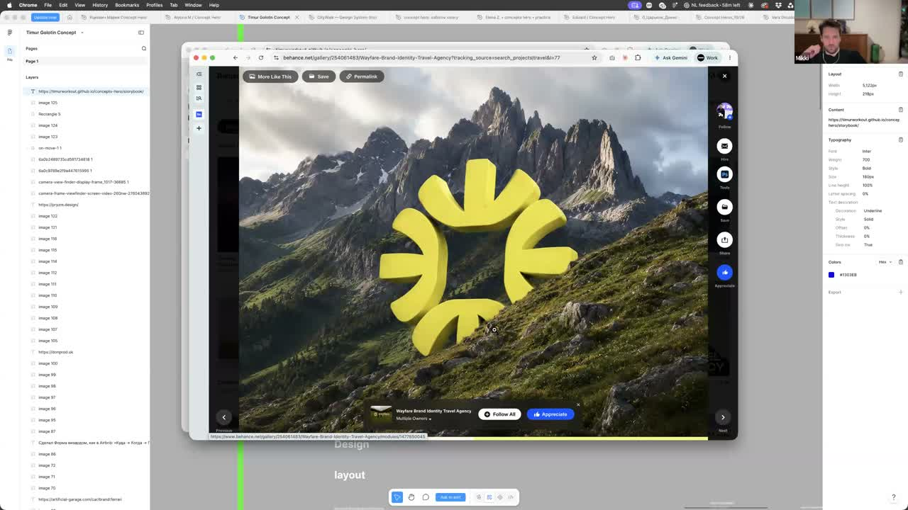
> «смотри, почти логотип… некая его вариация»

## 28:30 · «Go Slow, Make Memories»
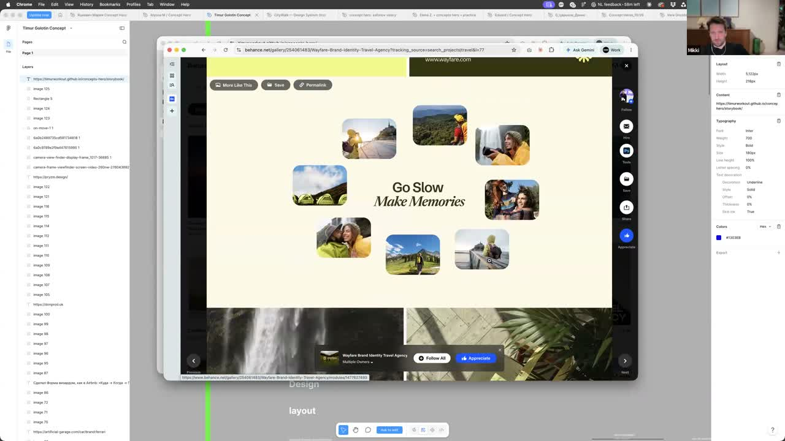
> «довольно примитивный выбор шрифтов, но он работает… работает лучше, чем твой»

## 28:37 · выдача (condensed-шрифты)
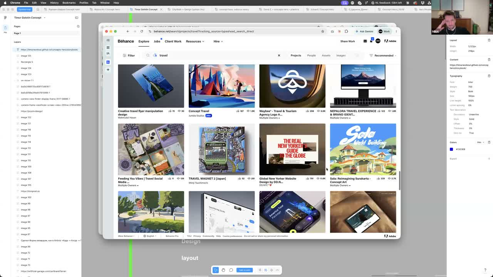
> «можно пойти в condensed-шрифты, очень популярные в этих делах»

## 28:47 · Le Petite Village, красный и фото
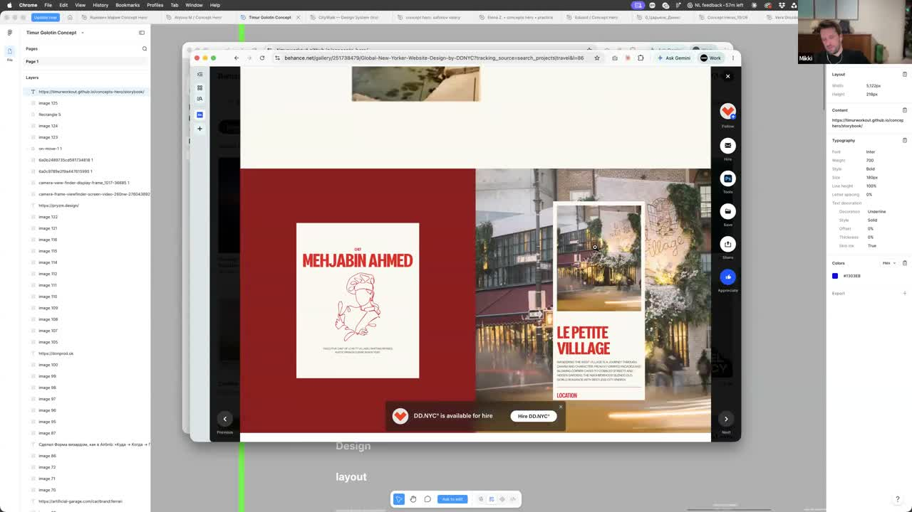
> «куча референсов… не знаю насчёт цвета, но в общем всё выглядит гораздо более подходящим, чем твои шрифтики»

## 29:06 · ключ и дверь, Италия
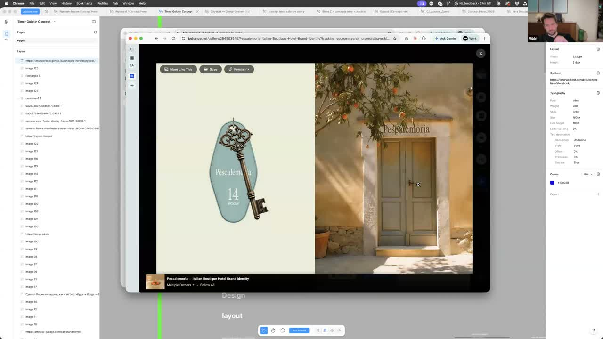
> «делал стилизацию по странам — вот это можно Италию сделать, супер будет»
